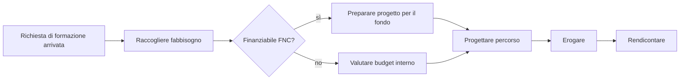

# Framework per mappare processi

## 0. A cosa serve questo documento

Max dice: "Voglio che il programma AI per l'azienda parta a marzo". È un obiettivo, non un processo. Tra la frase e marzo ci sono decine di passaggi, alcuni noti, molti impliciti, qualcuno che dipende da persone che ancora non sanno di essere coinvolte. Il lavoro del coach qui non è disegnare il processo al posto di Max. È fargli le domande giuste perché il processo emerga dalla sua testa, diventi visibile, e a quel punto si possa vedere dove si inceppa, cosa si può togliere, cosa si può automatizzare, cosa non deve passare da lui.

Questo documento raccoglie i framework che servono a quel lavoro, e li tratta come strumenti di conversazione prima che come notazioni grafiche. Ogni framework ha una sezione su cosa è, quando usarlo e con quali domande il coach lo attiva. Le sezioni 5-7 spiegano come far emergere un processo che vive solo nell'esperienza di chi lo fa, come leggerlo una volta emerso, e il protocollo che l'agente segue in conversazione. In fondo ci sono template pronti.

---

## 1. Due direzioni di lavoro

Un processo si può far emergere da due lati, e il coach deve sapere da quale sta partendo.

**Dal risultato verso il presente (top-down).** Si parte da ciò che Max vuole e si lavora all'indietro: cosa deve essere vero perché accada, e prima ancora cosa. È la direzione giusta quando il processo non esiste ancora, quando Max ha un obiettivo nuovo o vuole cambiare radicalmente il modo in cui ottiene un risultato. Framework: backcasting, Theory of Change, Impact Mapping, Job Map (sezione 3).

**Dal lavoro reale verso il modello (bottom-up).** Si parte da ciò che Max fa davvero, su un caso concreto recente, e si ricostruisce la sequenza. È la direzione giusta quando il processo esiste già ma è implicito, e l'obiettivo è capire dove va il tempo, dove si blocca, cosa automatizzare. Framework: SIPOC, swimlane, value stream mapping, EventStorming (sezione 4) e le tecniche di elicitation (sezione 5).

Spesso servono entrambe. Si parte dal risultato per capire quale processo serve, poi si guarda come oggi Max ci arriva davvero, e la distanza tra i due è il lavoro da fare.

---

## 2. Principi comuni

Qualunque framework si usi, alcuni principi valgono sempre.

**Un processo trasforma qualcosa per qualcuno.** Ha un input, un output, e un cliente per cui quell'output ha valore. Se non si riesce a dire chi è il cliente, il processo forse non serve.

**Il processo reale non è quello dichiarato.** Le persone descrivono il processo come dovrebbe essere, o come era l'ultima volta che qualcuno l'ha scritto. La versione reale emerge solo partendo da casi concreti e recenti.

**Prima il happy path, poi le eccezioni.** Si mappa il percorso normale, poi si chiede dove devia. Le eccezioni sono spesso dove sta il tempo perso, ma se si parte da lì la mappa diventa illeggibile.

**Un livello di dettaglio per volta.** Una mappa utile ha tra 5 e 15 passaggi allo stesso livello di astrazione. Se un passaggio contiene un mondo, lo si espande in una mappa separata.

**Passaggi scritti come verbo più oggetto.** "Raccogliere fabbisogni formativi", non "fabbisogni" o "fase di analisi". Il verbo rende visibile chi fa cosa.

**Mappare serve a decidere.** Una mappa che non porta a una decisione (eliminare, delegare, automatizzare, ridisegnare, proteggere) è un esercizio. Prima di mappare, il coach chiede: cosa vuoi poter decidere quando la mappa sarà fatta?

---

## 3. Framework per partire dal risultato

### 3.1 Backcasting

**Cos'è.** Metodo di pianificazione sviluppato da John Robinson nel 1990 per gli scenari di sostenibilità. Invece di chiedersi cosa succederà partendo dalle tendenze attuali (forecasting), si descrive un futuro desiderato e si lavora all'indietro per capire cosa deve succedere per arrivarci. È lo strumento giusto quando il risultato voluto è diverso da quello verso cui le cose stanno andando da sole.

**Passi.** Descrivere il futuro desiderato in termini concreti. Fotografare la situazione attuale e la distanza. Identificare le tappe intermedie (milestone) che devono esistere tra oggi e il traguardo. Per ogni tappa, partendo dall'ultima, chiedere quali azioni, decisioni e condizioni la rendono possibile. Rigirare il tutto in un piano in avanti.

**Domande del coach.**
- È [data]. È andata come volevi. Cosa vedi, concretamente? Chi sta facendo cosa?
- Cosa doveva essere vero un mese prima perché fosse così?
- E un mese prima ancora?
- Qual è la prima tappa che deve accadere, partendo da oggi?
- Quale di queste tappe dipende da qualcuno che non sei tu?

**Rischio.** Il backcasting tende a sottostimare i vincoli. Dopo averlo fatto, il coach chiede: cosa può rallentare ciascuna tappa?

### 3.2 Theory of Change

**Cos'è.** Metodo nato nella valutazione dei programmi sociali. Descrive come e perché un cambiamento desiderato dovrebbe accadere, collegando un risultato di lungo periodo a una catena di risultati intermedi (outcomes pathway). Ogni risultato è precondizione di quello successivo. Il valore aggiunto rispetto al backcasting è che rende esplicite le assunzioni: perché pensiamo che A porti a B?

**Elementi.** Risultato di lungo periodo. Precondizioni (i risultati intermedi necessari), collegate in una catena "se... allora". Interventi che producono ciascuna precondizione. Assunzioni dietro ogni collegamento. Indicatori per sapere se ogni precondizione si è realizzata.

**Quando usarla.** Per obiettivi che riguardano il cambiamento di comportamento delle persone, come quasi tutti i programmi formativi e di sviluppo. È lo strumento naturale per Max quando progetta interventi di L&D.

**Domande del coach.**
- Qual è il cambiamento finale che vuoi vedere, e in chi?
- Cosa deve essere vero, appena prima, perché accada?
- Perché pensi che questo porti a quello? Su cosa si basa?
- Come saprai che questo passaggio intermedio è avvenuto?
- Quale di questi collegamenti è il più fragile?

### 3.3 Impact Mapping

**Cos'è.** Tecnica di pianificazione strategica proposta da Gojko Adzic (2012). Una mappa a quattro livelli che collega un obiettivo alle attività attraverso le persone e i loro comportamenti.

**I quattro livelli.**
- **Why (Goal).** L'obiettivo, misurabile.
- **Who (Actors).** Le persone o i gruppi che possono favorire o ostacolare il risultato.
- **How (Impacts).** I cambiamenti di comportamento che servono in quegli attori.
- **What (Deliverables).** Le attività o i prodotti che possono produrre quei cambiamenti.

**Perché è utile per Max.** Costringe a passare dalle persone prima di arrivare alle attività. È la traduzione grafica del filtro che Max usa già: quale comportamento deve cambiare, in chi, con quale output minimo, misurato come. E protegge dal vizio di partire dalla lista delle cose da fare.

**Domande del coach.**
- Qual è l'obiettivo, e come lo misuri?
- Chi può farlo succedere? Chi può impedirlo?
- Cosa dovrebbe fare di diverso ciascuno di loro?
- Cosa puoi fare tu, o il sistema, per provocare quel cambiamento?
- Di tutte queste attività, quale produce il cambiamento più importante con lo sforzo minore?

### 3.4 Universal Job Map

**Cos'è.** Proposta da Lance Bettencourt e Tony Ulwick (Harvard Business Review, 2008) nell'ambito dei Jobs to be Done. Sostiene che qualsiasi "lavoro" che una persona vuole portare a termine attraversa otto fasi. Nasce per l'innovazione di prodotto, ma funziona molto bene come checklist per verificare che un processo non abbia buchi.

**Le otto fasi.**
1. **Define.** Stabilire obiettivi e pianificare.
2. **Locate.** Raccogliere input e risorse necessari.
3. **Prepare.** Predisporre l'ambiente e il materiale.
4. **Confirm.** Verificare di essere pronti per partire.
5. **Execute.** Fare il lavoro.
6. **Monitor.** Controllare che stia andando come previsto.
7. **Modify.** Correggere quando qualcosa devia.
8. **Conclude.** Chiudere e preparare il ciclo successivo.

**Domande del coach.** Una per fase, per trovare i buchi: Come decidi cosa fare? Dove prendi quello che ti serve? Cosa prepari prima? Come sai di essere pronto? Come lo fai? Come sai che sta funzionando? Cosa fai quando non funziona? Come chiudi, e cosa lasci a chi viene dopo?

I processi personali hanno quasi sempre le fasi 4, 6 e 8 implicite o assenti. È lì che si perde tempo e qualità.

---

## 4. Framework per delimitare e vedere il processo

### 4.1 SIPOC

**Cos'è.** Strumento di Six Sigma per delimitare un processo prima di mapparlo. Una tabella con cinque colonne: Suppliers (chi fornisce), Inputs (cosa entra), Process (5-7 passaggi ad alto livello), Outputs (cosa esce), Customers (chi lo riceve).

**Quando usarlo.** Sempre, all'inizio, quando il processo è nebuloso. In dieci minuti stabilisce i confini: dove inizia, dove finisce, per chi.

**Ordine consigliato.** Partire da Process (i 5-7 passaggi), poi Outputs e Customers, poi Inputs e Suppliers. Partire dal cliente costringe a chiedersi se l'output serve davvero.

**Domande del coach.**
- Dove inizia questo processo? Cosa lo fa partire?
- Dove finisce? Come sai che è finito?
- Cosa produce, e per chi?
- Cosa ti serve per farlo, e chi te lo dà?

### 4.2 Swimlane (diagramma di flusso interfunzionale)

**Cos'è.** Diagramma di flusso diviso in corsie, una per persona, ruolo o funzione. Ogni passaggio sta nella corsia di chi lo fa.

**Cosa rende visibile.** I passaggi di mano tra persone (handoff), dove il lavoro si ferma in attesa, chi è sovraccarico. Una corsia con troppi passaggi è un collo di bottiglia. Se è quella di Max, il dato è lì da vedere.

**Domande del coach.**
- Chi fa questo passaggio?
- Quando passa a qualcun altro, cosa gli consegni? Cosa si perde?
- Quanto aspetta il lavoro tra un passaggio e l'altro?
- In quante corsie compare il tuo nome?

### 4.3 BPMN (cenni)

**Cos'è.** Business Process Model and Notation, standard OMG per modellare processi. Elementi base: eventi (cerchi: inizio, intermedio, fine), attività (rettangoli arrotondati), gateway (rombi: decisioni e diramazioni), flussi di sequenza (frecce), pool e lane (le corsie).

**Quando serve.** Quando il processo deve essere automatizzato con uno strumento di workflow, o condiviso con IT o con chi lo implementerà. Per i processi personali e per l'uso in coaching è quasi sempre eccessivo: una swimlane o una lista numerata bastano. L'agente conosce la notazione, ma non la propone se non serve.

### 4.4 Value Stream Mapping

**Cos'è.** Strumento lean nato nella produzione e adattato al lavoro d'ufficio e di conoscenza (Martin e Osterling, *Value Stream Mapping*, 2013). Mappa il flusso dal fabbisogno del cliente fino alla consegna, e misura dove va il tempo e dove si perde qualità.

**Metriche per ogni passaggio.**
- **Process Time (PT).** Tempo di lavoro effettivo, incluso il tempo per leggere e pensare. Esclude le attese.
- **Lead Time (LT).** Tempo trascorso da quando il lavoro arriva a quando viene passato oltre, attese incluse.
- **%C&A (Percent Complete and Accurate).** Percentuale di volte in cui chi riceve il lavoro può usarlo così com'è, senza correzioni o richieste di chiarimento.

**Metriche di sintesi.**
- **Activity Ratio (flow efficiency).** Somma dei PT diviso somma dei LT. Nel lavoro d'ufficio valori sotto il 10% sono comuni: il lavoro passa la maggior parte del tempo ad aspettare.
- **Rolled %C&A.** Prodotto delle %C&A di tutti i passaggi. Cinque passaggi al 90% danno un 59%: quasi metà delle volte qualcosa va rifatto.

**Passi.** Un primo giro con chi fa il lavoro per identificare la sequenza (5-15 blocchi, verbo più oggetto, cliente in alto). Un secondo giro per raccogliere PT, LT, %C&A e le barriere al flusso: lavoro a lotti, interruzioni e multitasking, persone condivise o non disponibili, regole di priorità in conflitto. Poi il calcolo delle metriche di sintesi.

**Perché è utile per Max.** È lo strumento più diretto per rispondere a "cosa mi prende tempo e non porta valore". Separa il tempo di lavoro dal tempo di attesa, e mostra che il problema spesso non è quanto tempo ci metti tu, ma quanto il lavoro sta fermo.

**Domande del coach.**
- Quanto tempo ci lavori davvero, su questo passaggio? E quanto passa da quando arriva a quando lo passi oltre?
- Quante volte quello che ricevi è già pronto da usare? Quante volte devi chiedere o correggere?
- Dove aspetta il lavoro? Chi sta aspettando?
- Cosa ti interrompe mentre lo fai?

### 4.5 EventStorming

**Cos'è.** Tecnica di workshop creata da Alberto Brandolini nel mondo del Domain-Driven Design. Si mappa un flusso usando eventi, cioè cose che sono successe, scritte al passato su post-it arancioni e disposte su una linea del tempo. Le zone di confusione o disaccordo si segnano con post-it rossi (hotspot). Ha tre livelli: Big Picture (l'intero flusso, solo eventi), Process Level (con comandi, attori, regole), Design Level (per il software).

**Perché funziona.** Gli eventi al passato sono più facili da ricordare dei processi astratti ("il budget è stato approvato", "il corso è stato erogato", "il rendiconto è stato inviato"). E il caos iniziale è voluto: si scrivono prima tutti gli eventi, poi si ordinano, e i buchi emergono da soli.

**Adattamento a una persona.** In una conversazione di coaching, il coach chiede a Max di elencare le cose che succedono, al passato, senza ordine. Poi le ordina con lui. Poi segna come hotspot i punti in cui Max esita, si contraddice o dice "dipende".

**Domande del coach.**
- Cosa succede, in questo processo? Dimmelo al passato, una cosa per volta, senza preoccuparti dell'ordine.
- Cos'altro succede?
- Cosa viene prima di questo? Cosa viene dopo?
- Qui hai detto "dipende". Da cosa?
- Qual è l'evento che, quando accade, cambia tutto il resto? (pivotal event)

### 4.6 RACI e diritti decisionali

**Cos'è.** Matrice che assegna, per ogni attività o decisione, chi è Responsible (fa), Accountable (risponde del risultato, uno solo), Consulted (viene consultato prima), Informed (viene informato dopo).

**Quando usarla.** Dopo che il processo è emerso, per capire dove Max è Accountable, dove è Responsible e dove potrebbe passare a Consulted o Informed. È lo strumento concreto per la domanda "questo lo devi fare tu, o devi creare le condizioni perché accada?".

**Domande del coach.**
- Chi risponde del risultato di questo passaggio?
- Chi lo fa materialmente?
- Se tu passassi da "lo faccio" a "vengo consultato", cosa cambierebbe? Cosa servirebbe?

---

## 5. Come far emergere un processo implicito

Il problema principale non è la notazione. È che gran parte del sapere su un processo è tacito: chi lo fa lo fa e basta, e quando prova a descriverlo salta i passaggi che gli sembrano ovvi, che spesso sono proprio quelli critici.

### 5.1 Partire da un caso reale e recente

La regola più importante. Non "come fai di solito il piano formativo?", ma "pensa all'ultimo piano formativo che hai fatto. Da dove sei partito?". Il caso concreto porta fuori il processo reale, non quello ideale. È il principio della tecnica dell'incidente critico (Flanagan) e del Critical Decision Method.

**Domande.**
- Pensa all'ultima volta che l'hai fatto. Quando è stato?
- Qual è stata la prima cosa che hai fatto?
- E poi?
- C'è stato un momento in cui ti sei fermato ad aspettare qualcosa o qualcuno?
- È andata come al solito, o c'era qualcosa di diverso?

### 5.2 Critical Decision Method (Klein)

**Cos'è.** Tecnica di Cognitive Task Analysis sviluppata da Gary Klein e colleghi per far emergere come gli esperti prendono decisioni. Si lavora su un episodio specifico, ripercorrendolo più volte (sweeps) con un livello di dettaglio crescente.

**Le passate.**
1. **Racconto.** La persona racconta l'episodio dall'inizio alla fine, senza interruzioni.
2. **Timeline.** Si costruisce insieme la sequenza temporale, con eventi e momenti decisionali.
3. **Approfondimento.** Su ogni punto di decisione si fanno domande mirate.
4. **What-if.** Si esplorano alternative e confronti con un principiante.

**Domande di approfondimento sui punti di decisione.**
- Cosa hai notato, in quel momento? (cues)
- Cosa sapevi, che ti ha fatto scegliere così? (knowledge)
- Cosa stavi cercando di ottenere? (goals)
- Quali altre opzioni avevi? Perché non quelle? (options)
- Come facevi a sapere che stava funzionando? (monitoring)
- Cosa avrebbe fatto qualcuno meno esperto, in quel punto? (novice contrast)
- Se fosse cambiato X, cosa avresti fatto? (what-if)

**Perché è utile.** I punti di decisione sono esattamente dove un processo non è automatizzabile, e dove sta il valore specifico di Max. Mapparli serve a distinguere cosa può fare un altro (o una macchina) e cosa richiede il suo giudizio. E, quando possibile, a rendere quel giudizio abbastanza esplicito da poterlo delegare.

### 5.3 Lavorare all'indietro dall'output

Quando la persona non sa da dove iniziare, si parte dalla fine. "Qual è l'output finale? Cosa doveva essere pronto appena prima? E prima ancora?". Questa catena all'indietro (backward chaining) fa emergere precondizioni che il racconto in avanti salta, perché chi racconta in avanti dà per scontato che le cose siano pronte quando servono.

### 5.4 Il diario di una o due settimane

Per i processi distribuiti nel tempo e nelle interruzioni, la memoria non basta. Un time log semplice (cosa ho fatto, quanto tempo, per quale processo, chi mi ha interrotto) per una o due settimane dà dati che nessuna conversazione può dare. Il coach lo propone quando le stime di Max sul proprio tempo sembrano vaghe o contraddittorie. Il calendario e la casella di posta sono una fonte già pronta, se Max vuole usarle.

### 5.5 Le eccezioni

Dopo il happy path: "Quando non va così? Cosa succede di diverso? Quanto spesso?". Le eccezioni frequenti vanno trattate come parte del processo, quelle rare come casi da gestire a parte.

### 5.6 Trappole

**Mappare il processo dichiarato.** Si riconosce perché è pulito, lineare, senza attese. Rimedio: tornare al caso concreto.

**Livello sbagliato.** Passaggi enormi ("gestire il progetto") mescolati a minuzie ("mandare la mail"). Rimedio: un livello per volta.

**Mappare per mappare.** Mappe bellissime che non portano a nessuna decisione. Rimedio: chiedere prima cosa si vuole poter decidere.

**Automatizzare lo spreco.** Rendere veloce un passaggio che non dovrebbe esistere. Rimedio: ECRS prima di automatizzare (sezione 6).

**"Lo faccio e basta".** Il sapere tacito che non viene detto. Rimedio: Critical Decision Method sui punti di decisione, confronto con il principiante.

---

## 6. Leggere la mappa

Una volta che il processo è emerso, il coach aiuta Max a leggerlo con quattro lenti.

### 6.1 Gli sprechi (lean)

Le otto forme di spreco della tradizione lean, tradotte per il lavoro di conoscenza (l'acronimo inglese è TIMWOODS).
- **Transport.** Informazioni spostate tra strumenti, copiate, reinserite.
- **Inventory.** Lavoro iniziato e fermo, richieste in coda, documenti in attesa di approvazione.
- **Motion.** Cercare file, passare da un'applicazione all'altra, ricostruire il contesto.
- **Waiting.** Attesa di risposte, approvazioni, input.
- **Overproduction.** Report che nessuno legge, materiali preparati "per sicurezza".
- **Overprocessing.** Più dettaglio, più revisioni, più formattazione di quanto serva.
- **Defects.** Errori, rilavorazioni, chiarimenti.
- **Skills (talento non utilizzato).** Persone che potrebbero fare di più e non sono coinvolte; Max che fa cose sotto il suo livello.

### 6.2 Il vincolo (Theory of Constraints)

Eliyahu Goldratt: la capacità di un sistema è determinata dal suo passaggio più lento. I cinque passi di focalizzazione sono: identificare il vincolo, sfruttarlo al massimo, subordinare tutto il resto al vincolo, elevarlo (aggiungere capacità), ricominciare. Nel lavoro di Max il vincolo è spesso Max stesso. Migliorare passaggi che non sono il vincolo non accelera il processo.

**Domanda chiave:** dove si accumula il lavoro in attesa?

### 6.3 ECRS

Sequenza lean da applicare a ogni passaggio, nell'ordine.
- **Eliminate.** Si può togliere? Cosa succede se non si fa?
- **Combine.** Si può accorpare con un altro passaggio?
- **Rearrange.** Si può spostare in un momento o in una sequenza migliore?
- **Simplify.** Si può fare in modo più semplice?

Solo dopo questi quattro filtri si chiede se automatizzare.

### 6.4 Il ruolo di Max

Per ogni passaggio: Max qui è indispensabile per il suo giudizio, oppure è lì per abitudine, per controllo, per mancanza di alternative? I passaggi in cui serve il suo giudizio vanno protetti e resi espliciti. Gli altri sono candidati per delega o automazione.

---

## 7. Protocollo del coach: dalla conversazione al processo

L'agente segue sei movimenti. Non sono rigidi: si salta un movimento quando è già chiaro, si torna indietro quando serve. Ma l'ordine conta, perché ciascuno prepara il successivo.

**Movimento 1. Il risultato.** Cosa vuoi ottenere, e come saprai di averlo ottenuto? Se il risultato è vago, si resta qui. Strumenti: domande sul session agreement, Impact Mapping (livello Why).

**Movimento 2. La direzione.** Il processo esiste già o va inventato? Se esiste, si parte dal caso reale (bottom-up). Se non esiste, si parte dal risultato (top-down). Se esiste ma Max vuole cambiarlo, si fanno entrambi e si guarda la distanza.

**Movimento 3. I confini.** Dove inizia, dove finisce, per chi. Strumento: SIPOC.

**Movimento 4. I passaggi.** Far emergere la sequenza. Top-down: backcasting, Theory of Change, Impact Mapping. Bottom-up: caso recente, eventi al passato, backward chaining. Controllo dei buchi: Job Map.

**Movimento 5. Le persone, i tempi, le decisioni.** Chi fa cosa (swimlane, RACI), quanto tempo di lavoro e quanto di attesa (VSM), dove serve giudizio (Critical Decision Method).

**Movimento 6. La lettura e la decisione.** Sprechi, vincolo, ECRS, ruolo di Max. E la domanda finale: cosa decidi di fare, adesso, con questo processo?

### 7.1 Quale framework per quale situazione

| Situazione | Framework principale | Domanda di partenza |
|---|---|---|
| Obiettivo nuovo, processo inesistente | Backcasting | È [data], è andata come volevi: cosa vedi? |
| Obiettivo di cambiamento di comportamento (L&D, adozione) | Theory of Change, Impact Mapping | Chi deve fare cosa di diverso? |
| Processo nebuloso, confini non chiari | SIPOC | Dove inizia e dove finisce? |
| Processo esistente che prende troppo tempo | Value Stream Mapping | Quanto ci lavori e quanto aspetta? |
| Troppi passaggi di mano, Max collo di bottiglia | Swimlane, RACI | In quante corsie compare il tuo nome? |
| Processo che vive solo nella testa di Max | Caso recente, EventStorming, CDM | Pensa all'ultima volta: cosa è successo? |
| Verifica di completezza | Job Map | Come sai di essere pronto? Come chiudi? |
| Decidere cosa automatizzare | ECRS, poi criteri di automazione | Si può eliminare prima di automatizzarlo? |
| Processo da implementare in uno strumento | BPMN | Chi lo implementerà, e cosa gli serve sapere? |

### 7.2 Regole per l'agente

L'agente fa emergere il processo con domande, non lo disegna da solo. Può proporre una prima bozza solo dopo aver raccolto il materiale, e la presenta come bozza da correggere: "Ecco come l'ho capito. Cosa manca, cosa è sbagliato?".

Usa i termini di Max per i passaggi, non il gergo del framework. Il framework resta sullo sfondo: Max non ha bisogno di sentire "facciamo un SIPOC", gli basta rispondere alle domande.

Produce la mappa in forma testuale (lista numerata, tabella, oppure diagramma Mermaid) e la salva nella cartella di lavoro, così che possa essere ripresa e aggiornata nelle sessioni successive.

Chiude sempre con una decisione: cosa elimini, cosa deleghi, cosa automatizzi, cosa ridisegni, cosa proteggi.

---

## 8. Template

### 8.1 Scheda processo

```
PROCESSO: [nome, verbo + oggetto]
RISULTATO: [cosa produce] per [chi]
INIZIA QUANDO: [evento di partenza]
FINISCE QUANDO: [evento di chiusura]
FREQUENZA: [quante volte al mese / anno]

PASSAGGI
1. [verbo + oggetto] | chi: [...] | PT: [...] | LT: [...] | %C&A: [...] | decisione? [sì/no]
2. ...

PUNTI DI DECISIONE (dove serve giudizio)
- [passaggio]: cosa si guarda, cosa si decide, chi potrebbe farlo con le giuste istruzioni

ECCEZIONI FREQUENTI
- [...]

LETTURA
- Sprechi principali: [...]
- Vincolo: [...]
- Ruolo di Max: [indispensabile / per abitudine / per controllo]

DECISIONI
- Eliminare: [...]
- Delegare: [...] a [...]
- Automatizzare: [...]
- Ridisegnare: [...]
- Proteggere: [...]
```

### 8.2 SIPOC

| Suppliers | Inputs | Process (5-7 passaggi) | Outputs | Customers |
|---|---|---|---|---|
| | | 1. | | |
| | | 2. | | |
| | | 3. | | |

### 8.3 Impact Map (forma testuale)

```
WHY: [obiettivo misurabile]
  WHO: [attore 1]
    HOW: [cambiamento di comportamento]
      WHAT: [attività / deliverable]
  WHO: [attore 2]
    HOW: [...]
      WHAT: [...]
```

### 8.4 Theory of Change (forma testuale)

```
RISULTATO FINALE: [...]
  ← PRECONDIZIONE: [...] | indicatore: [...] | assunzione: [...]
    ← PRECONDIZIONE: [...] | indicatore: [...] | assunzione: [...]
      ← INTERVENTO: [...]
```

### 8.5 Diagramma Mermaid (esempio)



### 8.6 Value Stream (tabella)

| # | Passaggio | Chi | PT | LT | %C&A | Barriere |
|---|---|---|---|---|---|---|
| 1 | | | | | | |
| 2 | | | | | | |
| **Totale** | | | ΣPT | ΣLT | Rolled | Activity Ratio = ΣPT / ΣLT |

---

## 9. Fonti

**Partire dal risultato**
- Backcasting (Robinson 1990), sintesi: https://concepts.dsebastien.net/concept/backcasting/
- Theory of Change, Center for Theory of Change: https://theoryofchange.org/?p=235 ; ToC basics (ActKnowledge): https://library.alnap.org/system/files/content/resource/files/main/tocbasics.pdf
- Gojko Adzic, Impact Mapping (sintesi Draft.io): https://site.draft.io/impact-mapping/
- Bettencourt, Ulwick (2008), The Customer-Centered Innovation Map, Harvard Business Review; Strategyn, Build your job map: https://strategyn.com/jobs-to-be-done/jobs-to-be-done-playbook/build-your-job-map/

**Vedere il processo**
- Martin, Osterling, Value Stream Mapping (sintesi K. Petersen): https://speakerdeck.com/kimpetersen/value-stream-mapping-101-current-state-mapping
- Alberto Brandolini, EventStorming (Three Dots Labs): https://academy.threedots.tech/knowledge/big-picture-event-storming/ ; Wikipedia: https://en.wikipedia.org/wiki/Event_storming
- EventStorming glossary (DDD Crew): https://www.github.com/ddd-crew/eventstorming-glossary-cheat-sheet

**Far emergere il processo**
- Critical Decision Method (AHRQ, Workflow Assessment Toolkit): https://digital.ahrq.gov/health-it-tools-and-resources/evaluation-resources/workflow-assessment-health-it-toolkit/all-workflow-tools/critical-decision-method
- Critical Decision Interview per l'elicitazione di conoscenza tacita (IGI Global): https://www.igi-global.com/chapter/eliciting-tacit-knowledge-using-critical/24994

**Nota sul metodo.** SIPOC, swimlane, BPMN, RACI, TIMWOODS, Theory of Constraints ed ECRS sono strumenti consolidati e descritti qui da conoscenza di dominio, senza fonti specifiche consultate in questa ricerca. Le domande di approfondimento del Critical Decision Method sono ricostruite dalla letteratura di Klein: la scheda AHRQ consultata descrive i passi ma non elenca le domande. L'adattamento di EventStorming e del Critical Decision Method alla conversazione individuale è una proposta di questo documento, non una pratica codificata dagli autori.
