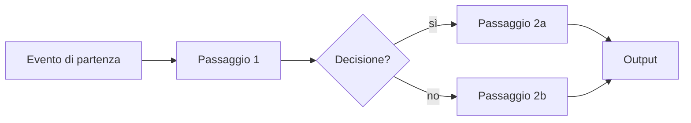

# m07 · Template di processo

**Usalo quando:** va prodotto l'output: scheda di processo, tabella, diagramma.

Presenta sempre l'output come bozza: "Ecco come l'ho capito. Cosa manca, cosa è sbagliato?". Salva in `artefatti/processi/[nome].md`.

## Scheda processo

```
PROCESSO: [verbo + oggetto]
RISULTATO: [cosa produce] per [chi]
INIZIA QUANDO: [evento]
FINISCE QUANDO: [evento]
FREQUENZA: [volte al mese / anno]

PASSAGGI
1. [verbo + oggetto] | chi: [...] | lavoro: [...] | attraversamento: [...] | % C&C: [...] | decisione: sì/no
2. ...

PUNTI DI DECISIONE
- [passaggio]: cosa si guarda, cosa si decide, chi potrebbe farlo con le giuste istruzioni

ECCEZIONI FREQUENTI
- [...]

LETTURA
- Sprechi: [...]
- Vincolo: [...]
- Ruolo del cliente: [...]

DECISIONI
- Eliminare: [...]
- Delegare: [...] a [...]
- Automatizzare: [...]
- Ridisegnare: [...]
- Proteggere: [...]
```

## Diagramma (Mermaid)



Per i passaggi di mano tra persone, aggiungi il nome tra parentesi: `B[Raccogliere fabbisogni (il cliente)]`.

## Impact map

```
PERCHÉ: [...]
  CHI: [...]
    COME: [...]
      COSA: [...]
```

## Copia da condividere

Quando il cliente vuole portare una scheda (di processo, di automazione, una sintesi di time audit) a un gruppo, a un'aula o a un responsabile:

1. Chiedi a chi va e per fare cosa. Ne dipende cosa serve tenere.
2. Parti dalla scheda in `artefatti/`, mai dalla memoria.
3. Togli: nomi e riferimenti a persone, note su energia, valori o goal personali, citazioni da `memoria/`, giudizi su colleghi o responsabili, dati che il cliente non ha scelto di condividere.
4. Tieni: il processo, i numeri del lavoro (frequenza, minuti, ore/mese), il gradino scelto, i rischi, il prossimo passo.
5. Mostra la copia e salvala solo dopo il suo ok, in `artefatti/condivisi/[nome].md`. L'originale resta dov'è.
