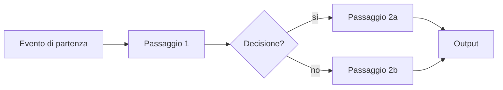

# m07 · Template di processo

**Usalo quando:** va prodotto l'output: scheda di processo, tabella, diagramma.

Presenta sempre l'output come bozza: "Ecco come l'ho capito. Cosa manca, cosa è sbagliato?". Salva in `artefatti/processi/[nome].md`.

## Scheda processo

```
PROCESSO: [verbo + oggetto]
RISULTATO: [cosa produce] per [chi]
INIZIA QUANDO: [evento]
FINISCE QUANDO: [evento]
FREQUENZA: [volte al mese / anno]

PASSAGGI
1. [verbo + oggetto] | chi: [...] | lavoro: [...] | attraversamento: [...] | % C&C: [...] | decisione: sì/no
2. ...

PUNTI DI DECISIONE
- [passaggio]: cosa si guarda, cosa si decide, chi potrebbe farlo con le giuste istruzioni

ECCEZIONI FREQUENTI
- [...]

LETTURA
- Sprechi: [...]
- Vincolo: [...]
- Ruolo del cliente: [...]

DECISIONI
- Eliminare: [...]
- Delegare: [...] a [...]
- Automatizzare: [...]
- Ridisegnare: [...]
- Proteggere: [...]
```

## Diagramma (Mermaid)



Per i passaggi di mano tra persone, aggiungi il nome tra parentesi: `B[Raccogliere fabbisogni (il cliente)]`.

## Impact map

```
PERCHÉ: [...]
  CHI: [...]
    COME: [...]
      COSA: [...]
```
