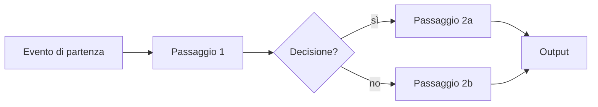

# m07 · Template di processo

**Usalo quando:** va prodotto l'output: scheda di processo, tabella, diagramma; oppure serve l'intestazione comune degli artefatti o una copia da condividere.

Presenta sempre l'output come bozza: "Ecco come l'ho capito. Cosa manca, cosa è sbagliato?". Salva in `artefatti/processi/[nome].md`.

## Intestazione comune degli artefatti

Ogni file in `artefatti/` (processi, automazioni, time audit, requisiti) apre con la stessa intestazione. Serve a riconoscere a colpo d'occhio cos'è, a che punto è e da cosa dipende, e la leggono anche gli strumenti.

```
---
tipo: processo / automazione / requisiti / time-audit
titolo: [verbo + oggetto]
stato: bozza / confermata / da costruire / attiva / archiviata
versione: 0.1
creata: AAAA-MM-GG
aggiornata: AAAA-MM-GG
collegata a: [altri artefatti, goal G..]
---
```

Regole:
- **Nome del file:** `[nome].md`, minuscolo, parole separate da trattini, verbo + oggetto (`raccogliere-fabbisogni.md`). Lo stesso `[nome]` lega scheda di processo, scheda di automazione e requisitazione della stessa attività, ognuna nella sua cartella.
- **Stato:** nasce `bozza`. Diventa `confermata` solo con il sì del cliente. `da costruire` vale solo per la requisitazione (criteri in `../coach-requisiti/r02-scrivere-requisiti.md`). `attiva` quando il processo nuovo o l'automazione girano davvero. `archiviata` quando non servono più: non si cancella.
- **Versione:** 0.x finché è bozza, 1.0 alla conferma. Ogni modifica dopo la conferma alza la versione e la data `aggiornata`.
- Una scheda modificata dopo la conferma torna `bozza` finché il cliente non riconferma.

Le schede di sessione in `memoria/sessioni/` non sono artefatti e non usano questa intestazione.

Le schede di processo, automazione e time audit sono passi verso la requisitazione, quando c'è qualcosa da costruire: la tabella in `../coach-requisiti/r02-scrivere-requisiti.md` dice quale campo finisce in quale sezione.

## Scheda processo

```
---
tipo: processo
titolo: [verbo + oggetto]
stato: bozza
versione: 0.1
creata: AAAA-MM-GG
aggiornata: AAAA-MM-GG
collegata a: [goal G.., automazioni/...]
---

PROCESSO: [verbo + oggetto]
RISULTATO: [cosa produce] per [chi]
INIZIA QUANDO: [evento]
FINISCE QUANDO: [evento]
FREQUENZA: [volte al mese / anno]

PASSAGGI
1. [verbo + oggetto] | chi: [...] | lavoro: [...] | attraversamento: [...] | % C&C: [...] | decisione: sì/no
2. ...

PUNTI DI DECISIONE
- [passaggio]: cosa si guarda, cosa si decide, chi potrebbe farlo con le giuste istruzioni

ECCEZIONI FREQUENTI
- [...]

LETTURA
- Sprechi: [...]
- Vincolo: [...]
- Ruolo del cliente: [...]

DECISIONI
- Eliminare: [...]
- Delegare: [...] a [...]
- Automatizzare: [...]
- Ridisegnare: [...]
- Proteggere: [...]
```

Alimenta la requisitazione: sezioni 3 (flusso) e 8 (eccezioni).

## Diagramma (Mermaid)



Per i passaggi di mano tra persone, aggiungi il nome tra parentesi: `B[Raccogliere fabbisogni (il cliente)]`.

## Impact map

```
PERCHÉ: [...]
  CHI: [...]
    COME: [...]
      COSA: [...]
```

## Copia da condividere

Quando il cliente vuole portare una scheda (di processo, di automazione, una sintesi di time audit) a un gruppo, a un'aula o a un responsabile:

1. Chiedi a chi va e per fare cosa. Ne dipende cosa serve tenere.
2. Parti dalla scheda in `artefatti/`, mai dalla memoria.
3. Togli: nomi e riferimenti a persone, note su energia, valori o goal personali, citazioni da `memoria/`, giudizi su colleghi o responsabili, dati che il cliente non ha scelto di condividere.
4. Tieni: il processo, i numeri del lavoro (frequenza, minuti, ore/mese), il gradino scelto, i rischi, il prossimo passo.
5. Mostra la copia e salvala solo dopo il suo ok, in `artefatti/condivisi/[nome].md`. L'originale resta dov'è.
6. Il Markdown resta la fonte. Se il cliente chiede un Word, esporta la copia confermata in `artefatti/condivisi/[nome].docx` (con pandoc, se c'è). Se l'export non riesce, dillo e consegna il Markdown: non riscrivere la scheda a mano in un altro formato. Nella copia l'intestazione si riduce a titolo, versione e data.
